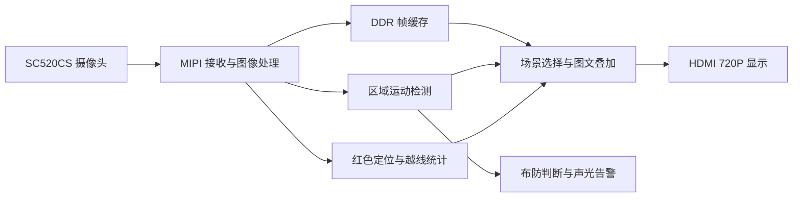

# 基于 FPGA 的智能安防监控系统

**720P 视频采集与显示 · 可设警戒区 · 运动声光告警 · 单红色目标双向越线计数**

本项目基于 **HX1P35A 开发板与 SC520CS 摄像头**，在 FPGA 上完成视频处理、目标检测、状态叠加和外设控制，通过 HDMI 输出 1280×720 画面。面向固定摄像头的区域监控场景，支持设置警戒区、布防后运动告警，以及单个红色目标的通过次数与方向统计。

[下载工程与烧录文件](https://github.com/KylerGu/fpga-security-monitor-hx1p35a/releases/latest) · [硬件连接与烧录](docs/HARDWARE_AND_FLASH.md) · [完整操作说明](docs/OPERATING.md)

## 主要功能

| 功能 | 实现与演示效果 |
|---|---|
| 视频采集与多场景显示 | 摄像头输入、DDR 帧缓存、720P HDMI 输出；按键切换原始彩色、灰度、边缘、运动检测和越线统计场景 |
| 区域运动告警 | 调整矩形警戒区的位置和尺寸；布防后，区域内运动触发 LED 与蜂鸣器，屏幕显示告警状态和事件次数 |
| 红色目标定位与越线统计 | 显示红色目标外接框及中心坐标；统计左→右、右→左的通过次数，显示最近通过方向 |
| 光照适应与调焦辅助 | 自动曝光、固定提亮、大面积光变保护；中心调焦框显示当前评分 F 与峰值 P，辅助手动调整镜头 |
| 运行状态可视化 | 叠加模式、布防状态、告警 CNT、通过次数 PASS、帧率 FPS 与缓存帧号差 LAT |

## 设计要点

- **检测与告警形成完整应用流程。** 从设置警戒区、布防，到运动确认、声光提示、静止后解除和事件计数，都可通过板载按键操作。
- **用确认规则减少边界误计数。** 越线判断采用中心线两侧缓冲区和连续帧确认；首次出现、线边停留、丢失后重现不会补算通过次数。
- **显示切换与后台统计分开。** 越线标注只在 PASS 场景显示，切换其他场景后后台仍继续统计；告警次数 CNT 与通过次数 PASS 分别记录。
- **兼顾异常输入与使用体验。** 光照突变时保护运动判定，断流后重新建立检测状态；告警计时使用持续运行的板载晶振，避免随摄像头时钟暂停。

## 系统组成

下图为功能处理链路，具体模块与时钟域划分见工程源码。

| 项目 | 配置 |
|---|---|
| 开发板 / FPGA | HX1P35A V1.0 / PH1P35MDG324 |
| 摄像头 | SC520CS |
| 视频输出 | HDMI，1280×720 |
| 帧存储 | 集成 DDR2，512 Mbit，x16 |
| 操作与提示 | 板载按键、拨码开关、LED、蜂鸣器与屏幕 OSD |
| 开发 / 仿真工具 | Tang Dynasty 6.2.168116 / ModelSim Altera Starter Edition 10.3c |

## 快速运行

1. 准备开发板、匹配的摄像头模组与排线、HDMI 显示器、USB 下载线及板卡规定的供电，按[连接说明](docs/HARDWARE_AND_FLASH.md)接好硬件。
2. 从 [Release](https://github.com/KylerGu/fpga-security-monitor-hx1p35a/releases/latest) 下载交付包，或直接获取 [最终 bit](bitstream/security_monitor_720p_ddr_fix.bit)。已有 bit 可直接用于演示，无需重新编译。
3. 在 BitWriter 中确认器件为 `PH1P35MDG324`，选择该 bit，以 `PROGRAM_SRAM`、5 MHz 临时下载。需要断电后自动启动时，按[烧录说明](docs/HARDWARE_AND_FLASH.md)写入并校验 Flash。

## 建议演示顺序

| 步骤 | 操作 | 观察内容 |
|---|---|---|
| ① 视频与算法切换 | 按 KEY2 循环切换 `RAW → GRAY → EDGE → MOTION → PASS` | 彩色、灰度、边缘等画面变化及模式标识 |
| ② 警戒区与运动告警 | SW1 进入 SET，KEY2 选择位置或尺寸，KEY3/KEY4 调整；退出 SET 后短按 KEY4 布防，在区域内移动物体 | 警戒区变化、告警状态、LED/蜂鸣器与 CNT；演示后短按 KEY4 撤防 |
| ③ 双向越线计数 | 切到 PASS；固定摄像头，让一个红色目标从左侧停稳后移到右侧，再返回左侧 | PASS 增加 2，L>R 与 R>L 各增加 1，最近方向更新 |
| ④ 手动调焦辅助 | SW3 开启调焦框，固定文字等有纹理目标，缓慢调整镜头并等待画面稳定 | F 评分随清晰度变化，P 保留本次峰值；SW4 可重置参考 |

KEY1 复位并清除全部计数。KEY4 长按约 3 秒只清告警 CNT，不清 PASS。蜂鸣器声音受板载 SW5 硬件开关控制。其他操作见[功能与按键说明](docs/OPERATING.md)。

## 验证与适用范围

交付检查已通过 **35 项功能仿真、1 项语法检查、DDR 时钟专项仿真**，并核对了 921,600 像素模拟帧的输出一致性。已有实板出图、告警、越线、调焦及 Flash 冷启动验收反馈；证据来源和测试范围见[验证说明](docs/VALIDATION.md)。工程整理时完成了独立目录展开与回归，没有重新执行全流程布局布线或上板测试。

当前越线功能面向**单个红色目标**，通过次数不是人数；多个红色物体会合并为一个外接框，没有独立目标 ID。计数最大为 999，断电不保存。LAT 表示缓存帧号差，不能直接作为端到端显示延迟。

## 工程入口

| 内容 | 位置 |
|---|---|
| FPGA 顶层 | [design_top_wrapper.v](project/user_source/hdl_source/design_top_wrapper.v) |
| 安防与计数模块 | [security/](project/user_source/hdl_source/security/) |
| TD 工程 | [camera_to_dsi_display.al](project/td_project/camera_to_dsi_display.al) |
| 引脚约束 | [pin.adc](project/user_source/constraints_source/pin.adc) |
| 仿真用例 | [simulation/](project/simulation/) |
| 构建、仿真与依赖安装 | [构建说明](docs/BUILD.md) |

摄像头接收、基础图像处理、存储和视频输出等底层模块沿用比赛官方资料中的例程与 IP；本项目在此基础上整合并扩展了安防交互、运动告警、红色定位、越线统计、曝光与调焦辅助。厂商版权与来源声明保留，详见[第三方说明](docs/THIRD_PARTY.md)。版本身份、文件指纹及恢复方法见[保存与恢复](releases/final_ddr_clock_fix_2026-11-01/README.md)。
